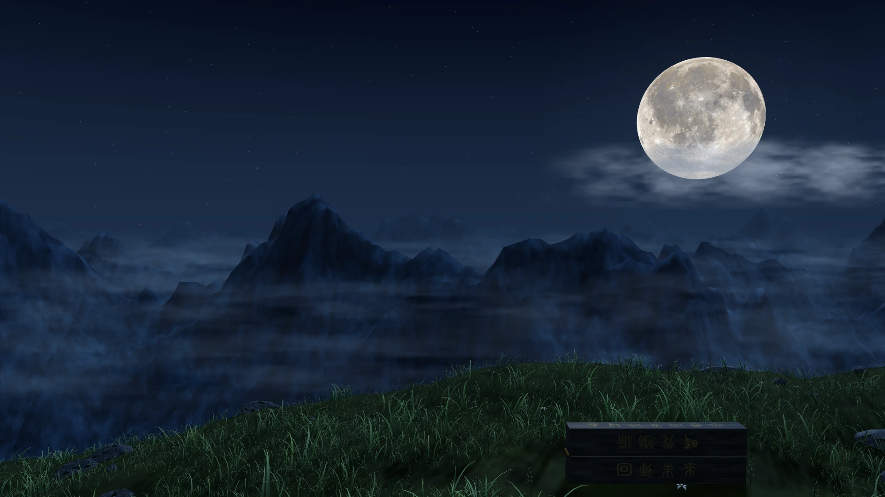

[中文](README.md) | [English](README.en.md)

# Moonlight Box Homepage

A cinematic personal homepage built with TypeScript, Three.js, and Vite. A real-time 3D scene combines moonlight, rocks, grass, and a Moonlight Box, with two text links leading to a blog and another site.



This existing repository image is a **scene background preview** and one of the static fallback assets. It does not include the complete page copy, links, or animation. This repository does not provide a live demo URL.

## Features and interactions

- A moonlit landscape with lunar imagery, mountains, rocks, layered vegetation, clouds, stars, meteors, moonlight, and contact shadows.
- Activating the box prompts the visitor to choose a text link; the box itself does not select a destination.
- Two text links have separate destinations. An ordinary click starts the box opening, light curtain, calligraphic inscription, and ink transition; navigation waits for a black frame.
- Three.js crown and monkey entry icons include interaction animations and PNG fallbacks.
- Separate desktop, tablet, mobile, and short-screen compositions, with layout and quality selected independently.
- The system's `prefers-reduced-motion` setting pauses or simplifies relevant animations. Dynamic updates pause while the page is in the background.
- Keyboard entry, accessible text, and static backgrounds and links for unavailable WebGL, resource failures, and disabled JavaScript. Interactive transitions do not run without JavaScript.

## Stack and requirements

[package.json](package.json) and [package-lock.json](package-lock.json) define the dependency versions: Three.js `0.186.1`, TypeScript `7.0.2`, and Vite `8.3.5`, using ES modules.

Use **Node.js 22.18+** and npm, installing from the lockfile. Tests run TypeScript directly with Node's built-in test runner and `--experimental-strip-types`; older Node versions may not support the command. Routine development, tests, and builds do not require Python.

## Quick start

Download and extract the source from the actual repository page, or clone using the real URL provided there. Enter the project directory (adjust its name to match your download):

```sh
cd homePage
npm ci
npm run dev
```

Open the local URL printed in the terminal, usually `http://127.0.0.1:5173`. If that port is occupied, use the printed URL. The development server binds to the local machine by default. Do not open `index.html` by double-clicking it.

| Command | Purpose |
| --- | --- |
| `npm ci` | Install dependencies from the lockfile |
| `npm run dev` | Start the local Vite development server |
| `npm test` | Run `tests/*.test.ts` |
| `npm run build` | Check TypeScript, then generate `dist/` |
| `npm run preview` | Preview an existing production build locally |
| `git diff --check` | Check the diff for whitespace errors |

For a production preview, run `npm run build`, then `npm run preview`, and open the URL printed in the terminal.

## Configuration

The main settings are in [src/config.ts](src/config.ts):

| Setting | Purpose |
| --- | --- |
| `pageConfig.title`, `titleLines` | Browser title at runtime and the two-line page heading |
| `pageConfig.description` | Introductory copy |
| `entranceLabel`, `worldLabel`, `loadingLabel` | The two link labels and loading greeting |
| `blogUrl`, `worldUrl` | Each link's navigation destination |
| `pageConfig.transition` | Charge, spread, inscription delay and writing durations, plus reduced-motion durations, in milliseconds |
| `sceneConfig.layout`, `layoutRules` | Camera position, target height, field of view, moon position, and layout selection rules |
| `sceneConfig.quality` | Desktop/mobile pixel-ratio caps, shadow sizes, vegetation and other scene object counts |

The current configuration is `blogUrl: "https://blog.jinsc.icu/"` and `worldUrl: "https://kk.jinsc.de5.net/"`. Check both destinations before deployment; change the configuration and rebuild when publishing for other sites. The second link navigates to its configured destination; this homepage does not query server status.

Update the static `<title>`, SEO description, and relevant fixed no-script copy in [index.html](index.html) as needed; not all of them are generated from `pageConfig`. Box choice-prompt durations are in [src/choice-prompt.ts](src/choice-prompt.ts); entry icon animations are in [src/entry-motion.ts](src/entry-motion.ts). Recheck all target viewports after camera or quality changes to catch obstructed links and clipped models.

## Glyph and asset maintenance

Some text uses pregenerated SVG glyphs rather than a complete font downloaded at runtime. Changing strings alone can cause missing glyphs, build failures, plain-text title fallback, or a mismatch between the inscription and accessible text:

- Calligraphic glyphs for descriptions, the loading greeting, and link labels live in [src/calligraphy-glyphs.ts](src/calligraphy-glyphs.ts). After editing these strings in `src/config.ts`, regenerate them with `python scripts/build-inscription.py --copy-only`.
- Seal-script outlines for headings and box engravings live in [src/title-glyphs.ts](src/title-glyphs.ts) and [src/scene/seal-glyphs.ts](src/scene/seal-glyphs.ts). Add outlines from the same source and aliases where needed for new characters; the command above does not generate seal-script glyphs.
- The inscription uses [src/assets/inscription.svg](src/assets/inscription.svg), with its text constant in [src/inscription-strokes.ts](src/inscription-strokes.ts). Changes require updating the sentence, glyphs, and manually adjusted stroke paths in [scripts/build-inscription.py](scripts/build-inscription.py), then regenerating the resource. Editing the text constant alone is insufficient.

These are **optional asset-authoring tools**, not routine startup or build steps:

| Tool | Requirements and output |
| --- | --- |
| `python scripts/build-inscription.py --copy-only` | Python, fontTools, and Shapely; generates static calligraphic glyphs. Downloads the font and OFL to ignored `output/calligraphy/` on first use |
| `python scripts/build-inscription.py` | Same requirements; also rebuilds the inscription SVG and its attribution record. Inspect the script before overwriting manually adjusted resources |
| `python scripts/prepare-entry-artwork.py` | Python and Pillow; generates layered crown and monkey textures, moonlight/color variants, and three cursor PNG sets from archived artwork |
| `scripts/capture-scene.cjs` → `python scripts/build-assets.py` | Capture five scene layouts on the development page with Playwright CLI, then convert them to `public/assets/scene-*.webp`; see below |
| `scripts/export-entry-stills.cjs` → `python scripts/save-entry-stills.py` | Export entry first frames from the development server, then save CLI output as `public/assets/entry-*.png`; see below |

Prepare Python dependencies in a separate asset-authoring environment; the repository has no Python lockfile. Preserve source attribution, modification notes, and license records when replacing assets. See [third-party notices](THIRD_PARTY_NOTICES.md).

### Entry artwork and generation workflow

Offline source artwork is archived in [assets/source/entry-artwork/](assets/source/entry-artwork/) and is not loaded directly by the page:

| Source | Purpose |
| --- | --- |
| [staff-and-monkey-hands.png](assets/source/entry-artwork/staff-and-monkey-hands.png) | Golden staff, pointing monkey hand, and grabbing monkey hand |
| [crown-and-monkey-head.png](assets/source/entry-artwork/crown-and-monkey-head.png) | Crown base, left/right feathers, and monkey face |

Install Pillow in the authoring environment once (`python -m pip install Pillow`). Run the following commands from the repository root; the generator itself resolves input and output paths relative to its script location. First run `python scripts/prepare-entry-artwork.py` to generate moonlight/color crown and monkey textures and layered/native `cursor-staff`, `cursor-point`, and `cursor-grab` assets. It does not generate entry first frames; export those next:

1. Run `npm run dev` in another terminal and use its actual URL. This requires the development server because the exporter imports `/src/` modules.
2. Prepare Playwright CLI and its browser, create `output/playwright/`, then run (adjust the URL to the terminal output):

```sh
playwright-cli open http://127.0.0.1:5173
playwright-cli run-code --filename scripts/export-entry-stills.cjs > output/playwright/entry-stills.txt
python scripts/save-entry-stills.py output/playwright/entry-stills.txt
```

The saver writes 36 transparent first frames to `public/assets/`: moonlight/color crown and monkey variants and red-eyed monkey variants, at 30, 36, and 44 sizes with 1×/2× pixel density. Commit changed source artwork, authoring scripts, runtime PNGs that actually changed, and attribution records. Keep existing filenames and `/assets/` URLs; exclude temporary export text. When replacing artwork, check that crop coordinates and transparency masks still fit, then follow [testing and acceptance](#testing-and-acceptance) for both entry icons, all three cursors, and fallback images.

### Five static scenes

Keep the development server running and execute on its open page:

```sh
playwright-cli run-code --filename scripts/capture-scene.cjs
python scripts/build-assets.py
```

| Scene | Capture viewport | Runtime asset |
| --- | --- | --- |
| Desktop | 1920×1080 | `scene-desktop.webp` |
| Tablet | 768×1024 | `scene-tablet.webp` |
| Mobile | 390×844 | `scene-mobile.webp` |
| Short landscape | 844×390 | `scene-short.webp` |
| Short portrait | 320×480 | `scene-short-portrait.webp` |

The capture script hides only text, interaction layers, and cursors, saving the real scene to `output/playwright/scene-*.png`. The converter requires all five inputs before producing WebP files under `public/assets/`. Short portrait uses its own image rather than a crop of the landscape image. Rebuild and check normal rendering, WebGL fallback, and JavaScript-disabled layouts in production preview; never capture an existing fallback background as a new scene.

## Project structure

```text
index.html                 Page shell, startup guard, and no-script entry
src/
  main.ts                  Startup, interactions, navigation, and lifecycle
  config.ts                Copy, destinations, transitions, camera, and quality
  scene.ts                 Main Three.js scene coordinator
  scene/                   Terrain, vegetation, rocks, box, sky, lighting, disposal
  responsive.ts            Camera fitting, projected bounds, and framing
  transition.ts            Journey state and light-curtain progress
  inscription*.ts          Inscription strokes, timing, and visible time
  ink-*.ts                 Ink geometry, rendering, timing, black-frame navigation gate
  entry-*.ts               3D entry icons, animations, and rendering
  static-html.ts           Static copy and link generation during dev and build
  *glyphs.ts / calligraphy.ts / title.ts
                           Pregenerated glyphs and text rendering
  style.css                Layout, responsive styles, and static backgrounds
  assets/                  Inscription SVG inlined at build time
assets/source/entry-artwork/ Offline entry and cursor originals, not loaded by the page
public/assets/             Lunar texture, static scenes, entry textures, cursors, fallbacks, licenses
tests/                     Node unit and regression tests
scripts/                   Browser checks, recordings, captures, optional asset tools
```

`dist/`, `output/`, `.playwright-cli/`, and `node_modules/` are ignored directories. Do not commit generated output.

## Deployment

1. Check both destinations, adjust them for this deployment as needed, and check static metadata and glyphs.
2. Run `npm ci`, `npm test`, and `npm run build`.
3. Publish the **contents of `dist/`** to a static host, preserving the directory structure. Page requests do not require a Node server.
4. At the deployed URL, check asset loading, both links, mobile framing, and static fallbacks.

The current default is deployment at the **domain root**. Code, styles, and HTML contain root-absolute paths such as `/assets/`. For a subdirectory such as `/homepage/`, **changing Vite's `base` alone is insufficient**: also audit and adjust those paths, icons, static backgrounds, and fallback assets, then rebuild and verify. `npm run preview` is for local checks, not production hosting.

## Testing and acceptance

Before submitting changes, run:

```sh
npm test
npm run build
git diff --check
```

These commands do not replace real-browser acceptance. For visual changes, check desktop (for example, 1920×1080), mobile (390×844), and short-screen (844×390) views, retaining screenshots and viewport dimensions. When affected, check reduced motion, unavailable WebGL, load failures, context loss, and disabled JavaScript.

Most `scripts/verify-*.cjs` and capture scripts are `async (page) => { ... }` functions passed to a browser executor, not standalone Node programs. Prepare Playwright CLI and its browser separately, start the local server, then invoke from the repository root, for example:

```sh
playwright-cli open http://127.0.0.1:5173
playwright-cli run-code --filename scripts/verify-layout.cjs
playwright-cli run-code --filename scripts/verify-fallback.cjs
```

Use the actual server address; scripts usually derive the origin from the current page. Create `output/playwright/` first and read each script's header and contents. Scripts that import `/src/` or intercept source modules, such as `verify-scene-runtime.cjs` and `verify-entry-icon-fallbacks.cjs`, require the development server. For production checks, build first, then run layout, interaction, fallback, and history-return scripts that support built assets against the preview URL.

Ordinary navigation checks read the actual destinations from page links and supply controlled destination pages at the browser network boundary. Abort unmatched external requests so checks cannot visit real sites. For custom configuration checks, `verify-static-links.cjs` requires both URL-encoded `expectedBlogUrl` and `expectedWorldUrl` parameters in the test page URL; the second expectation has no default. Locate the main scene with `#scene canvas` to avoid selecting entry-icon or ink canvases.

Playwright CLI is not a project npm dependency, and `npm test` does not automatically run these browser scripts. Automated results apply only to the tested environment. Mobile viewport emulation does not replace checks on physical devices such as iPhones running Safari; report the browser, device, and scope behind compatibility or performance claims.

## Troubleshooting

| Problem | Action |
| --- | --- |
| Node reports an unknown flag or unsupported syntax | Check `node --version` and the executable being used; use the recommended Node.js 22.18+ and install from the lockfile |
| Opening HTML directly shows a blank page or placeholders | Use the Vite server or serve the built output over HTTP. Source HTML requires Vite transformation and cannot be used via `file://` |
| Only the static background appears | Check the console, WebGL, asset requests, and load errors. This is a fallback path; text links should remain accessible |
| A link opens an unexpected destination | Check `blogUrl` and `worldUrl` in `src/config.ts`, then rebuild and deploy after changes |
| Copy changes cause missing glyphs or build failures | Regenerate calligraphic glyphs; maintain heading and inscription resources separately as described above |
| Images disappear under a subdirectory | Audit root-absolute asset paths. Vite's `base` alone does not cover every `/assets/` reference |

## Contributing and licensing

Read [CONTRIBUTING.md](CONTRIBUTING.md) before submitting a bug, suggestion, or code change. Use the repository's Issue / PR templates to describe reproduction and verification.

Original project code and documentation are available under the [MIT License](LICENSE), Copyright (c) 2026 Klaus-Kin. Third-party imagery, fonts, and derived glyphs retain their own terms; the repository's MIT license does not replace them. See [THIRD_PARTY_NOTICES.md](THIRD_PARTY_NOTICES.md) for attribution and preservation requirements.
